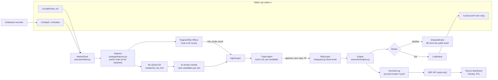

# Strategy, AI role and risk management

> **خلاصه:**
> - **هر معامله زنده، یک تصمیم مشترک ML و مدل زبانی است:** مدل یادگیری ماشین (LightGBM، بازده خالص انتظاری ۲ ساعته) سه بازار BTCTMN، ETHTMN و USDTTMN را هر ساعت رتبه‌بندی می‌کند. افسر ریسک (مدل زبانی محلی Qwen3 8B) باید حالت ریسک را OFF نکرده باشد، عامل معامله باید کاندید را تأیید کند و RiskGuard حرف آخر را می‌زند.
> - **ریسک:** هر معامله ۲۵۰ هزار تومان، سفارش میکر روی بهترین قیمت خرید، حد سود ۰٫۸٪، حد ضرر ۱٪ و حداکثر ۲ ساعت نگهداری. کلید توقف در −۲٫۵٪ و سقف ضرر روزانه −۲٪.
> - **نتیجه صادقانه:** بک‌تست ۱۴ روزه با کارمزد واقعی −۱٫۳۴٪ است. لبه پیش‌بینی‌پذیر بازار از کارمزد رفت‌وبرگشت (~۰٫۵٪) کمتر است. نسخه «فقط E[net] > 0» تقریباً سربه‌سر است، ولی فقط ۰٫۱۴ معامله در روز دارد.
> - **درس‌ها:** کارمزد در برابر لبه، رانش کاهش ارزش تومان، و ارزان‌تر بودن ~۲٫۵ برابری کارمزد بازارهای USDT.

Evidence for every number is in `docs/RESEARCH_P2.md` (data, costs, rules), `docs/RESEARCH_P3.md` (ML),
`docs/RESEARCH_P4.md` (LLM roles, ablation), `reports/` and `reports/experiments.jsonl` (every experiment run).

## 1. Architecture

- **One code path:** shadow and live run the same `Engine`; only the broker differs. The backtester uses the same
  `strategy/`, `risk/guard.py` and feature code.
- **The engine loop** (every 15 s): refresh candles → refresh orders (each processed once) → mark equity at the best
  bid minus the taker fee → stops against the best bid → RiskGuard status (kill, daily block, end-of-challenge
  flatten) → on a new 5m bar, the strategy cycle → reconcile with the account every 30 s → state + heartbeat.
- **Restart safety:** positions and open orders are restored from `logs/engine_state_<mode>.json`; the exchange is
  the truth (reconcile). An unknown open order on the account halts new entries.

## 2. What trades (live configuration, `config/live.toml`)

User decision 2026-10-22: the trend rules are **off** in live (G1: −1.61% over 14 days, 6 trades, all stopped out).
The only live module is **AI activity** (`strategy/modules/ai_activity.py`):

- **Universe:** BTCTMN and ETHTMN, the deepest TMN books (2–4 bps slippage). USDTTMN was removed on 2026-10-23:
  the prop account refuses orders on it. It stays in the data (features, fair value).
- **Every 60 min slot:** rank the three markets by the ML model's calibrated expected net return over 2 h (E[net],
  h24 = 24 five-minute bars, already net of costs). Propose them in that order as **one exclusive group**: the engine
  takes at most one approved entry per slot.
- **Each candidate needs, in order:**
  1. the Officer's `risk_mode` ≠ OFF and the market not on its avoid list;
  2. the Trade Agent's approval (it may also reduce the size, tighten the stop, bring the target closer);
  3. RiskGuard's approval.
  A rejected top candidate lets the next one be evaluated. Every rejection and skip is logged with its reason.
- **Buy:** maker LIMIT at the best bid (taken again after the LLM review), 3 min timeout, one reprice at the new
  bid, then cancel.
- **Sell:** resting maker take-profit at +0.8%; stop at −1.0% checked against the best bid (engine-side, market
  sell); after 2 h a limit at the best ask, then market after 120 s.
- **Size and limits:** 250,000 TMN per trade (the exchange minimum is 50,000), at most 2 positions, 12 entries per
  Tehran day, 45 min between entries, sizes ×0.5 for the first 2 h of live.
- **Live refuses to start** with `ai_activity` enabled unless both LLM roles are on: every trade is an ML + LLM decision.

## 3. The AI's role

| | ML model (LightGBM) | Regime/Risk Officer (LLM) | Trade Agent (LLM) |
|---|---|---|---|
| when | every 5m bar | every hour (4 h in historical replay) | each candidate |
| sees | 41 causal features: returns, volatility, trend, fair value vs USDT, breadth, hour | market-only summary (returns, volatility, trend, TMN premium over USDT × USDTTMN, breadth, Tehran hour) | the candidate (stop/target distances, signals), the same summary, read-only Wallex tools in live (≤ 3 calls) |
| decides | E[net] → rank | NORMAL / DEFENSIVE (half size) / OFF, markets to avoid | approve/reject, smaller size, tighter stop, closer target |
| on failure | no candidate | OFF: no new entries, exits keep running | reject |

- **Local, zero cost, offline, pinned:** Ollama `qwen3:8b`, digest `500a1f067a9f…` (`config/llm.toml`), JSON schema
  output, temperature 0, seed 42. No paid API (team decision).
- **Auditable:** every LLM call is journaled with `provider/model@digest`, prompt version and request hash; the
  engine copies each role decision into the decision log (`kind: LLM`), and the verdict text goes into the
  trade's ENTER/REJECT record.
- **Reproducible:** every answer is cached in `data/llm_cache/` (committed); `make reproduce` replays the ablation
  without any model or network.
- **Blind historical replay:** no dates and no price levels reach the model, so it cannot recall the period.
- **Ablation** (`docs/RESEARCH_P4.md` §5; 13 selection windows, base fees): the LLM roles did **not** improve
  returns (mean −0.04% rules vs −0.05% with both roles) but cut the worst drawdown from −2.30% to −1.81% and
  the worst window from −1.58% to −0.85%. An equal-exposure control (rules ×0.76, no LLM) gets −1.75% worst
  drawdown, so most of that benefit is a size cut. The Officer was DEFENSIVE in half the blocks and mostly
  avoided BTC/ETH; the Trade Agent approved 79% and usually trimmed size to 0.8. We keep the roles as an
  auditable risk governor that can only reduce risk, not as a source of return.

## 4. Risk management (code, final word)

RiskGuard (`risk/guard.py`, pure) checks every entry; LLM output passes through it and can only reduce risk.

| rule | live value |
|---|---|
| max per position / total exposure | 15% / 45% of equity |
| one position per market, no averaging down | yes |
| daily loss (Tehran day) | −2%: no new entries until the next day |
| kill switch (from the starting equity) | −2.5%: flatten everything to TMN and halt |
| end of challenge | no entries in the last 2 h; flatten in the last 60 min (limit at best, then market); check ≥ 99% TMN |
| market policy | default-deny allowlist + organizer blocklist, checked at startup and before every order |
| self-trade guard | our resting opposite orders are cancelled before a crossing order |
| minimum order / precision | exchange minimum 50,000 TMN, Decimal everywhere, price/amount decimals |
| ramp | sizes ×0.5 for the first 2 h of live |
| errors | 5 consecutive errors halt new entries (exits keep running); the halt lifts after 40 clean loops (~10 min) |
| POST safety | never retried blindly: after a transport error the order is looked up by its client_id |

## 5. Results

**Live run (prop account, 2026-10-23 11:38 → 23:00 Tehran):** 5,000,000 → 4,994,555 TMN (**−0.109%**; TMN only
−0.218%, the rest is 0.0000085 ETH of unsellable dust). Two ETHTMN round trips: one 2-hour max-hold exit
(−993 TMN), one stop (≈ −3,250 TMN, filled at −1.36% vs the −1% stop); pre-live smoke tests cost 873 TMN.
`FINAL ok: true` (100% TMN excluding dust). Logs: `reports/decision_logs/live_decisions.*`.

What the live run taught us (all fixed or documented, see CHANGELOG):
- **The exchange differs from its docs:** MARKET orders and USDTTMN orders are refused on the prop account;
  the buy fee is taken in the coin (0.25% maker / 0.30% taker) and the sell fee in TMN. Forced exits became
  re-placed aggressive limits; USDTTMN left the live markets.
- **Coin-side fees + a coarse amount step make dust:** ETH's 0.00001 step left ~6,000 TMN per trade that
  cannot be sold below the minimum order. Every sell now uses the available balance, and dust is reported.
- **Operations matter:** the laptop sleeping (on battery, lid closed) stopped the engine for ~2 h. It halted
  entries and resumed without help, but a stop cannot be checked while the machine sleeps; run it on a server.
- **Open bugs at the end:** the take-profit of a repriced entry is not rounded to the price step (rejected by
  the exchange in trade 2; the stop still protected it), and the journal's approximate P&L is wrong for that trade.

All fee tables use the **measured** fees from `GET /v1/account/fee` (2026-10-23): TMN maker 0.25% / taker 0.30%.

**AI activity fix check** (`reports/ai_fix_check`, last 14 days to 2026-10-22, ML-only proxy, walk-forward predictions;
(b) and (c) were chosen after seeing (a) on the same data, so they are optimistic):

| variant | return (measured / ×1.5 / low 0.15/0.20) | max DD | trades/day | worst 3 days |
|---|---|---|---|---|
| (a) current live config | −1.34% / −1.81% / −0.99% | −1.39% | 2.57 | −0.39% |
| (b) only E[net] > 0 | +0.03% / 0.00% / +0.05% | −0.07% | 0.14 | −0.04% |
| (c) (b) + 15m trend up | 0 trades | 0 | 0 | 0 |

- (a) approves ~12.6 entries a day, but only 36 of 177 maker orders at the bid filled: they fill when the price
  falls (adverse selection). Gross P&L per trade −0.23% before ~0.55% of fees.
- (b) is the only variant that does not lose, but 2 trades in 14 days is no evidence of an edge and it misses
  the ≥ 1 trade/day activity target.

**The live configuration (a) with both LLM roles** (`reports/ai_activity_llm`, last 7 days, measured fees,
blind replay): ML only −0.67% (20 trades) → + Officer −0.53% (15) → **+ Officer + Trade Agent −0.32%, max DD
−0.36%, 11 trades (1.57/day)**. The Trade Agent approved 25 of 245 candidates. **Decision (team, 2026-10-23):** keep (a) with
both roles (the current `config/live.toml`): the smallest loss that still meets ≥ 1 trade/day; (b) would be
the choice only if not losing matters more than activity.

**Per-trade P&L (honesty addendum, `docs/RESEARCH_P4.md` §6).** Size-free columns (% of the trade's notional) measure selection quality:

| variant | trades | mean P&L per trade (TMN) | per trade, % of equity | mean notional (TMN) | gross per trade, % of notional | net per trade, % of notional | wins |
|---|---|---|---|---|---|---|---|
| ML only | 20 | −1,679 | −0.034% | 247,708 | −0.15% | −0.68% | 2 |
| + Officer | 15 | −1,751 | −0.035% | 222,840 | −0.29% | −0.81% | 1 |
| + Officer + Trade Agent | 11 | −1,468 | −0.029% | 198,674 | −0.22% | −0.74% | 2 |

- **The improvement comes from fewer and smaller trades, not from better selection.** Per unit of notional, the
  trades the LLM let through were slightly *worse* than the ML-only trades (net −0.74% vs −0.68%). At the ML-only
  per-trade mean, 11 trades would lose ~18,500 TMN (−0.37%); the LLM run lost −0.32%, the rest of the gap being its
  ~20% smaller sizes (Officer DEFENSIVE half sizes, Trade Agent trims).
- **Sample:** 7 days, 11–20 trades, 1–2 winners per variant: far too small for a selection claim either way.
- **What it means for live:** the roles act as a brake that cuts the number and size of loss-making trades in a
  market where the module has no edge. That is a real risk benefit, but it is not skill at picking trades.

- **Earlier phases:** trend rules (P2) about break-even per 3-day window at default fees; per-bar ML has real
  ranking skill (IC 0.12 at 1h) but the predictable move is smaller than a round trip (P3).

**Shadow** (`reports/decision_logs/`, dashboard): the full chain runs in real time: ranking, Officer, Trade Agent
rejections with reasons, maker orders, reprice, cancel.

## 6. What we learned

1. **Fees beat the predictable edge.** The ML model ranks 1–2 h returns better than chance (IC ≈ 0.12), but the
   moves it can predict are smaller than a TMN round trip (maker 0.25% + taker 0.30%, plus slippage). Every
   short-horizon variant we tried loses roughly its fees. The honest conclusion: on TMN markets at these fees,
   a short-horizon system should trade rarely, only when the expected move clearly exceeds the round-trip cost.
2. **TMN devaluation is a drift, not skill.** USDTTMN rose ~76% in 180 days (BTCTMN +86%). Any long-only TMN
   strategy looks good in history just by holding, so every table shows buy-and-hold. A USDT regime allocation
   did not capture the drift (it comes in jumps that a closed-bar filter enters late) and was negative on
   detrended prices too: no timing edge.
3. **USDT-quoted markets are ~2.5× cheaper.** USDT pairs cost maker 0.10% / taker 0.13% (a maker round trip of
   0.20% vs 0.50% on TMN). The same ML signals clear that hurdle far more often. Future direction: trade the
   USDT pairs and keep one TMN conversion at each end (the challenge is scored in TMN).
4. **Maker fills are adversely selected.** A bid that fills usually means the market moved down through it, so a
   maker entry strategy needs a trend or momentum filter, or a crossing entry when the edge is large.
5. **Operations matter as much as the signal.** In shadow we found and fixed: DNS outages that halted entries for
   good, a bar clock that froze at night (quiet markets get no trailing bars), and a slow local LLM eating the
   entry timeout. Each has a test now.

## 7. SMC / ICT research module (researched; off in live)

`research/smc/` (features, `smc_long` module, experiments), parameters in `config/smc.toml`, `config/live.toml`
`[smc] enabled = false`. Not on the live path: not registered in `strategy/factory.py`. Results and the gate:
`docs/RESEARCH_SMC.md`.

**Definitions** (pure functions, closed bars only, no lookahead; a test checks that no value changes when later
bars arrive). Structure on 1h, setup on 15m, trigger on the 5m clock; long only.

| concept | quantified definition |
|---|---|
| swing high / low | fractal pivot: high[i] > the N highs before it and ≥ the N after it (lows mirrored), N = 3; known only at bar i + N |
| BOS up / down | a close above the last confirmed swing high (below the last confirmed swing low), counted once per level |
| structure | bullish after a BOS up, bearish after a BOS down; CHoCH = the first BOS against the prior structure |
| bullish liquidity sweep | a low under the last confirmed swing low (or a cluster of equal lows within 0.1%) and a close back above that level within ≤ 2 bars |
| displacement (up) | an up bar with body ≥ 1.5 × ATR(14), or a 3-bar rise ≥ 2 × ATR |
| bullish FVG | low[i] > high[i−2]; zone [high[i−2], low[i]]; size ≥ 0.3 × ATR; valid until a close below the zone bottom or 48 bars |
| bullish order block | the last down-close bar before a displacement that produced a BOS up; zone [low, open]; invalid on a close below its low |
| premium / discount | position in the dealing range (sweep low → target swing high); long only below 50% (discount) |

**`smc_long` entry:** 1h structure bullish → a 15m bullish sweep → within 8 bars a displacement that breaks
structure up (BOS or CHoCH) and leaves an FVG (or OB) → a maker LIMIT at the top of that zone on the retrace
(timeout, then cancel) → stop under the sweep low (min 0.8%, cap 2%) → take-profit at the nearest swing high
above (buy-side liquidity), required ≥ 1.5 R and ≥ 0.7% (fee floor) → only in discount. Max hold 4 h.

**Result: rejected.** It fails the live gate (last 14 days −0.15% with 0.14 trades/day; SMC features do not
improve the ML model: IC 0.070 → 0.069, SHAP ranks 31–48 of 48). Details: `docs/RESEARCH_SMC.md`.
